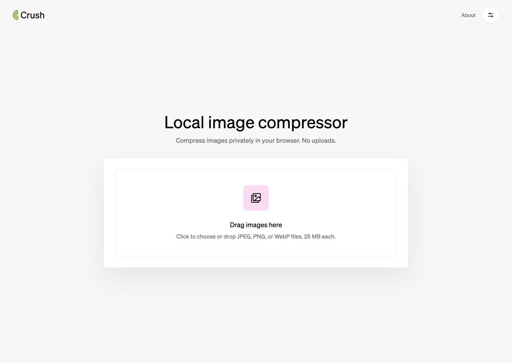
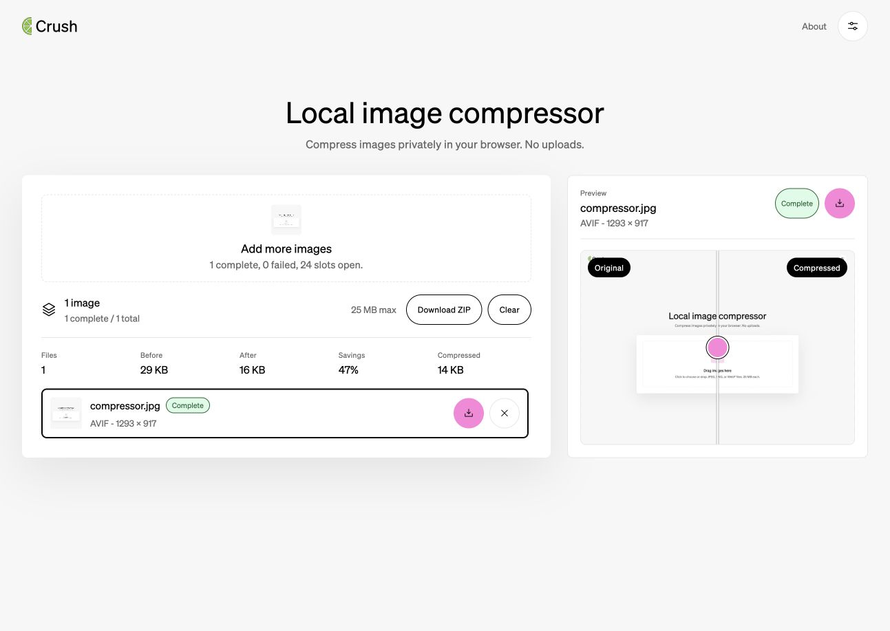

# Crush

**Smaller images. Your files stay on your device.**

Crush is an offline-first image compression app built with Svelte 5 and TypeScript.
Convert JPEG, PNG, and WebP images to AVIF, WebP, JPEG, or lossless PNG directly in your
browser, compare the results, and download individual files or a batch ZIP. No account
or image upload is required.

**[Try the live demo →](https://crush.nicomarston.dev/)**



## Try it in a minute

1. Open [Crush](https://crush.nicomarston.dev/) and choose or drop your images.
2. Open **Compression settings** to choose an output format and quality preset.
3. Compare the original and compressed image, check the size savings, and download
   individual results or the whole batch as a ZIP.

The demo needs no credentials. Images are processed locally in your browser.

## Features

- **Batch compression:** up to 25 images, with a 25 MB limit per file.
- **Four output formats:** AVIF by default, plus WebP, JPEG, and lossless PNG.
- **Quality presets:** High Quality, Balanced, and Smallest File.
- **Visual comparison:** inspect the original and result with a comparison slider.
- **Size reporting:** see before/after sizes and savings for each batch.
- **Flexible downloads:** save one result or download the batch as a ZIP.
- **Offline support:** an installable PWA with cached app assets after the first successful load.
- **Light and dark themes.**



*Screenshots captured from the live app. Compression savings vary with image content,
format, and settings; the example is not a benchmark.*

## How it works

The SvelteKit interface manages the batch, settings, progress, and previews. Compression
runs in a **Web Worker** so the encoding work stays off the main UI thread.

| Part | Implementation |
| --- | --- |
| Interface | Svelte 5, SvelteKit, TypeScript |
| AVIF encoding | `@jsquash/avif` WebAssembly encoder |
| PNG optimization | `@jsquash/oxipng` lossless WebAssembly optimizer |
| JPEG and WebP encoding | Browser-native canvas APIs |
| Batch downloads | `fflate` ZIP generation |
| Offline app shell | Service worker via `@vite-pwa/sveltekit` |
| Hosting | Static assets on Cloudflare Workers |
| Development | Vite+ |

The app has no server-side image processing endpoint. Source images and encoded results
stay in the browser; hosting serves the app and its assets.

## Run locally

Use a Node.js version supported by `package.json` (`^20.19.0`, `^22.18.0`, or
`>=24.11.0`) and install the [Vite+ CLI](https://viteplus.dev/guide/).

```sh
git clone https://github.com/nrmarston/crush.git
cd crush
vp install
vp dev
```

Open the local URL printed by the development server.

| Command | Purpose |
| --- | --- |
| `vp check` | Run configured project checks |
| `vp test` | Run the unit test suite |
| `vp build` | Create the static production build in `build/` |
| `vp preview` | Preview the production build locally |
| `vp run deploy` | Build and deploy with Wrangler; requires Cloudflare authentication |

The tests cover batch job state, image metadata, output formats, compression behavior,
PNG optimization, and comparison/preview logic.

### Check offline mode

Build and preview the app, load it once while online, and allow the service worker to
cache its assets. Then enable offline mode in browser DevTools, reload, and compress a
local image.

## Tradeoffs and limitations

- AVIF encoding can take longer than browser-native JPEG or WebP encoding.
- PNG output uses lossless optimization and keeps the original dimensions.
- Large images and batches are limited by the device's available browser memory.
- Crop, watermark, animated PNG preservation, and custom codec controls are not included.
- Completed jobs belong to the current batch; persistent compression history is not included.

## Explore the code

- [`src/routes/+page.svelte`](src/routes/+page.svelte): main compression interface.
- [`src/lib/batch-compression-job.svelte.ts`](src/lib/batch-compression-job.svelte.ts): batch lifecycle and progress.
- [`src/lib/workers/compressor.worker.ts`](src/lib/workers/compressor.worker.ts): worker-based encoding.
- [`docs/adr/`](docs/adr/): compression architecture decisions.

Built by [Nico Marston](https://github.com/nrmarston).
